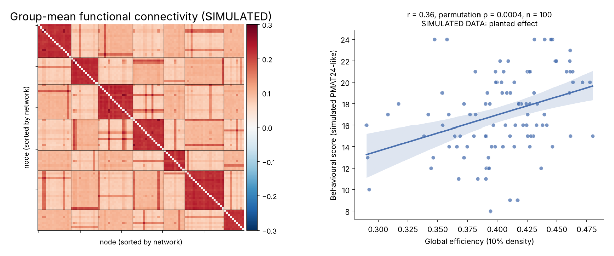

# Resting-State Brain Network Topology and Fluid Intelligence



> ⚠️ **The figure above uses simulated placeholder data** with a deliberately planted effect, because Human Connectome Project data can't be redistributed. Follow [Getting the HCP data](#getting-the-hcp-data) and flip one switch to run the identical pipeline on real data.

## What this project does

A graph-theory pipeline for resting-state fMRI from the [Human Connectome Project](https://www.humanconnectome.org) (HCP Young Adult, S1200 release). It asks whether the topology of a person's functional brain network relates to their fluid-intelligence score.

1. **Load** parcellated resting-state time series (100 nodes per subject) for a subset of 100 subjects, plus a behavioural score (`PMAT24_A_CR`, Penn Progressive Matrices).
2. **Build functional connectivity matrices** (100 × 100 Pearson correlations per subject) with `nilearn.connectome.ConnectivityMeasure`, Fisher-z averaged at group level.
3. **Turn each matrix into a graph** at fixed density (10% of possible edges) using a minimum-spanning-tree backbone plus the strongest edges, so every graph is connected and has the same number of edges.
4. **Compute graph metrics** with NetworkX: clustering coefficient, characteristic path length, global efficiency, modularity, small-worldness σ against degree-preserving random graphs, and hubs (top 10% in both degree and betweenness).
5. **Relate network topology to behaviour**: Pearson correlation with a 5,000-shuffle permutation test, Spearman as a rank-based check, Bonferroni correction across four metrics, and a pre-specified primary metric (global efficiency) so the headline plot isn't cherry-picked.
6. **Robustness check**: repeat at 5%, 10%, 15% and 20% density.

| Figure | File |
|---|---|
| Group connectivity heatmap, ordered by network | `figures/connectivity_heatmap.png` |
| Brain metric vs. behavioural score | `figures/brain_behavior_scatter.png` |
| Group graph with hubs highlighted | `figures/group_graph_hubs.png` |
| Correlation vs. graph density | `figures/density_robustness.png` |

### Results on the simulated data (not real findings)

The pipeline recovers the planted effect: global efficiency vs. score r = 0.36 (permutation p = 0.0004, n = 100), significant after Bonferroni correction and stable from 5% to 20% density (r = 0.33 to 0.39). The group graph is small-world (σ ≈ 3.5). This validates the code, nothing more. Large studies (Marek et al., 2022, *Nature*) suggest real resting-state brain–behaviour correlations are usually small (|r| ≲ 0.16), so expect a weaker or null result on real HCP data with n = 100.

## Setup

```bash
git clone <your-repo-url> && cd <repo>
python -m venv .venv && source .venv/bin/activate      # Windows: .venv\Scripts\activate
pip install -r requirements.txt
jupyter notebook hcp_network_analysis.ipynb
```

On simulated data the whole notebook runs in under a minute on a laptop.

## Getting the HCP data

HCP data is free, but you must personally accept a Data Use Agreement. Nobody can do this for you, and **the data must never be committed to GitHub** (`data/` is in `.gitignore`).

1. Go to [humanconnectome.org](https://www.humanconnectome.org) → **Data** → **ConnectomeDB** and create a free account.
2. Accept the **WU-Minn HCP Consortium Open Access Data Use Terms**. The *Restricted* terms aren't needed for this project.
3. In the **WU-Minn HCP Data – 1200 Subjects** project, download:
   - **HCP1200 Parcellation + Timeseries + Netmats (PTN)**. Extract the 100-node (`d100`) MSMAll node time series: one text file per subject, *timepoints × 100 nodes*.
   - **Behavioral Data** (unrestricted CSV), which has a `Subject` column and `PMAT24_A_CR`.
4. Arrange them like this:
   ```
   data/
     node_timeseries/3T_HCP1200_MSMAll_d100_ts2/<subject_id>.txt
     unrestricted_behavioral.csv
   ```
5. In the notebook's configuration cell set `USE_SYNTHETIC = False` (and adjust paths or `BEHAVIOR_COLUMN` if yours differ). Run all cells.
6. Rewrite the *Interpretation* section and this README's results paragraph with your real numbers.

ConnectomeDB's menus and archive names have changed over the years. If something above doesn't match, the HCP S1200 Reference Manual and data dictionary are the authority.

## Limitations

- **No motion correction covariate yet.** Head motion strongly affects connectivity and correlates with behaviour. Add mean framewise displacement as a covariate on real data.
- **Related subjects.** HCP includes twins and siblings. Family-aware permutation testing needs the Restricted data.
- **ICA nodes aren't anatomical regions.** For anatomically named hubs, parcellate the CIFTI data with an atlas (e.g. Schaefer-100 via Nilearn).
- **Threshold choices matter.** Only binary graphs at a range of densities are tested here; weighted metrics are a natural extension.

## Repository layout

```
hcp_network_analysis.ipynb   # full pipeline, runs top to bottom
figures/                     # generated figures + results CSV
requirements.txt
.gitignore                   # keeps HCP data out of git
```

## Data acknowledgement

If you use real HCP data, include the acknowledgement wording required by the HCP Data Use Terms: data were provided by the Human Connectome Project, WU-Minn Consortium (Principal Investigators: David Van Essen and Kamil Ugurbil; 1U54MH091657). Copy the exact text from the Data Use Terms page.
